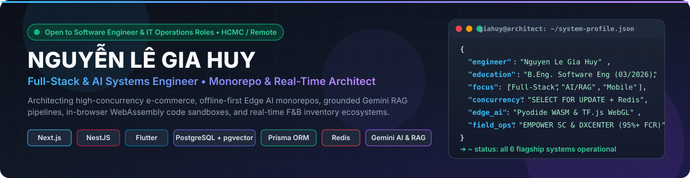
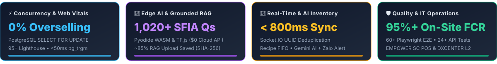
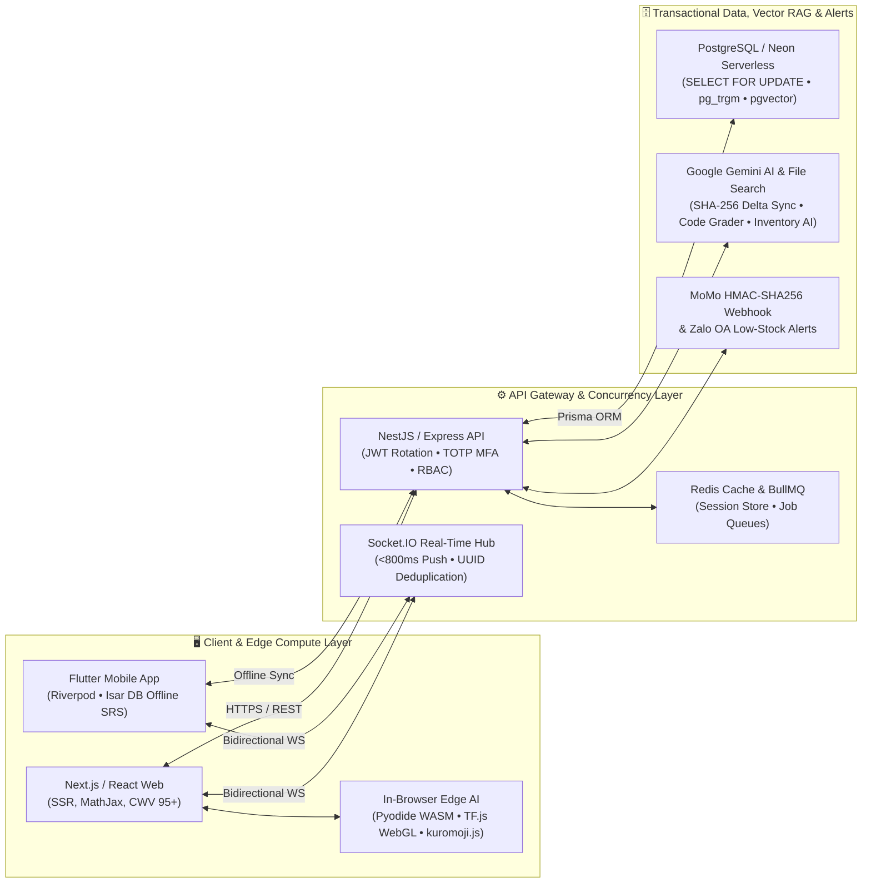

 

 

---

## 🧑‍💻 Executive Summary

- 🎓 **Software Engineering Graduate** from **HUTECH University** (*09/2021 – 03/2026*, GPA: `2.86/4.0`, CEFR B1 English).
- 💼 **Production & Field IT Operations Experience** at **EMPOWER SC** (*Dimchan All-in-One POS/ERP*, `12/2025 – 06/2026`) and **HCMC Digital Transformation Center — DXCENTER** (*Provincial Project Contract at Binh Khanh Ward Digital Transformation Center*, `08/2025 – 10/2025`).
- ⛩️ **Lead Architect of [HyperGlot](https://github.com/nlgiahuy01112003/HyperGlot)** (*03/2026 – Present*) — Enterprise Japanese learning Turborepo monorepo combining **Next.js**, **NestJS**, **Flutter + Isar DB** (offline-first SRS), **Manifest V3 Chrome Extension**, **Neon PostgreSQL (`pgvector`)**, and zero-cost client-side Edge AI (**TensorFlow.js WebGL** & **kuromoji.js**).
- 🛒 **Creator of [TechStore (Vanfio)](https://github.com/nlgiahuy01112003/techstore)** (*09/2025 – 03/2026*) — High-concurrency electronics e-commerce platform (**Next.js App Router**, **React**, **NestJS**, **PostgreSQL**, **Prisma ORM**, **Redis**) enforcing pessimistic row-level locking (**`SELECT FOR UPDATE`**) and **HMAC-SHA256** idempotent MoMo payment webhooks.
- 🧠 **Creator of [AI Mock Exam Platform](https://github.com/nlgiahuy01112003/ai-exam-live)** (*08/2026 – 09/2026*) — Full-stack **SFIA Level 3–4** AI Engineer & Data Scientist assessment engine (**Next.js**, **NestJS**, **Pyodide WebAssembly** in-browser Python sandbox, **Gemini AI Code Grader**, **Neon Serverless PostgreSQL**, **MathJax LaTeX**, and **1,020+ standardized questions**).
- 🤖 **Creator of [OptiBot RAG System (KB-Harvest)](https://github.com/nlgiahuy01112003/kb-harvest)** (*06/2026 – 07/2026*) — Automated knowledge harvesting & grounded RAG pipeline (**Python**, **Zendesk REST API**, **SHA-256 delta sync** reducing daily uploads by **~85%**, **Gemini File Search**, **Docker**, and **GitHub Actions Cron**).
- 🧋 **Creator of [POMI Milk Tea](https://github.com/nlgiahuy01112003/pomi_web)** (*03/2024 – Present*) — Multi-platform real-time F&B ordering & AI recipe inventory system (**React**, **Express TypeScript**, **PostgreSQL**, **Flutter**, **Socket.IO `<800ms` sync** with UUID deduplication, **Recipe & Ingredient Inventory Engine** separating Base drinks vs. Toppings, **Gemini AI Assistant**, and automated **Zalo Low-Stock Alerts**).

---

## 📄 Specialized Resume / CV Hub (2-Page A4 Standard)

> Every CV below is strictly engineered and verified to render on **exactly 2 A4 pages** with ATS-friendly semantic structure.

| Target Engineering / IT Role | Key Focus & Core Stack | 🇻🇳 Vietnamese Version (VI) | 🇬🇧 English Version (EN) |
| :--- | :--- | :---: | :---: |
| **🚀 Full-Stack Software Engineer** | Next.js, React, NestJS, Flutter, PostgreSQL (`pgvector`), Prisma ORM, Redis, Gemini RAG | [🌐 View Online](https://nguyenlegiahuy-portfolio.vercel.app/career/cv-nguyen-le-gia-huy-vi.html) · [📥 PDF](./cv/cv-nguyen-le-gia-huy-vi.pdf) | [🌐 View Online](https://nguyenlegiahuy-portfolio.vercel.app/career/cv-nguyen-le-gia-huy.html) · [📥 PDF](./cv/cv-nguyen-le-gia-huy.pdf) |
| **🎨 Frontend & Edge AI Engineer** | Next.js App Router, React, Tailwind CSS, SCSS, TensorFlow.js WebGL, Pyodide WebAssembly, 95+ CWV | [🌐 View Online](https://nguyenlegiahuy-portfolio.vercel.app/career/cv-frontend-intern-vi.html) · [📥 PDF](./cv/cv-frontend-intern-vi.pdf) | [🌐 View Online](https://nguyenlegiahuy-portfolio.vercel.app/career/cv-frontend-intern.html) · [📥 PDF](./cv/cv-frontend-intern.pdf) |
| **⚙️ Backend & Database Engineer** | NestJS, Express, PostgreSQL (`SELECT FOR UPDATE`), Prisma ORM, Redis, Socket.IO, RAG ETL | [🌐 View Online](https://nguyenlegiahuy-portfolio.vercel.app/career/cv-backend-intern-vi.html) · [📥 PDF](./cv/cv-backend-intern-vi.pdf) | [🌐 View Online](https://nguyenlegiahuy-portfolio.vercel.app/career/cv-backend-intern.html) · [📥 PDF](./cv/cv-backend-intern.pdf) |
| **🛠️ IT Helpdesk / Manual QA Tester** | Dimchan POS/ERP, DXCENTER Portals, E2E Manual QA, Hardware/LAN Diagnostics, 95%+ FCR | [🌐 View Online](https://nguyenlegiahuy-portfolio.vercel.app/career/cv-it-helpdesk-tester-vi.html) · [📥 PDF](./cv/cv-it-helpdesk-tester-vi.pdf) | [🌐 View Online](https://nguyenlegiahuy-portfolio.vercel.app/career/cv-it-helpdesk-tester.html) · [📥 PDF](./cv/cv-it-helpdesk-tester.pdf) |
| **🤝 Product / Application Support** | SLA Triage, Root-Cause Analysis, SQL Debugging, Dev L2 Bug Escalation, Client Deployment | — | [🌐 View Online](https://nguyenlegiahuy-portfolio.vercel.app/career/cv-product-support-intern.html) · [📥 PDF](./cv/cv-product-support-intern.pdf) |

---

## 💻 Technical Expertise Matrix

| Domain | Production Technologies & Tooling |
| :--- | :--- |
| **Languages** |         |
| **Frontend & Edge AI** |         |
| **Mobile & Offline-First** |   -00BCD4?style=flat-square) |
| **Backend & Real-Time** |       |
| **Databases & Vectors** |      |
| **AI, RAG & Messaging** |     |
| **QA, Security & DevOps** |       |

---

## 🗺️ System Architecture Blueprint

---

## 🏆 Flagship Engineering Projects

### 1. ⛩️ [HyperGlot — AI-Driven Japanese Language Learning Ecosystem](https://github.com/nlgiahuy01112003/HyperGlot)
**Role:** Lead Full-Stack / Mobile Architect | **Timeline:** `03/2026 – Present`
> Enterprise-grade Japanese learning platform (JLPT N5–N1) engineered as a Turborepo monorepo under a strict **Zero-Cost API Strategy**.

- 🏗️ **Turborepo Monorepo Architecture**: Unified `apps/web` (Next.js learner portal), `apps/admin` (TanStack Table & Recharts analytics), `apps/mobile` (Flutter + Riverpod + Isar DB), `apps/api` (NestJS, scrypt auth, Redis, BullMQ), `packages/database` (Prisma ORM), and a Manifest V3 Chrome Extension.
- ⚡ **Client-Side Edge AI (`$0` Cloud Inference)**: Migrated kanji stroke order recognition to client-side **TensorFlow.js with WebGL hardware acceleration** and morphological tokenization to **kuromoji.js** in-browser — eliminating network round-trip latency and recurring cloud API bills.
- 🔍 **Native `pgvector` Semantic Search**: Leveraged PostgreSQL `pgvector` on Neon Serverless for contextual JLPT vocabulary/grammar retrieval without costly external vector databases.
- 📱 **Offline-First Mobile Sync**: High-speed **Isar DB** local storage enables students to complete FSRS spaced repetition card reviews seamlessly without internet connectivity, syncing asynchronously upon reconnection.
- 🧪 **Enterprise QA & Accessibility**: Backed by **60+ automated test cases**, **Playwright E2E** cross-browser suites, **WCAG 2.1 AA** compliance, and **OWASP Top 10** security hardening.

---

### 2. 🛒 [TechStore (Vanfio) — Concurrency-Controlled E-Commerce Platform](https://github.com/nlgiahuy01112003/techstore)
**Role:** Full-Stack Developer | **Timeline:** `09/2025 – 03/2026` | 🌐 **Live Demo:** [website-for-aunt.vercel.app](https://website-for-aunt.vercel.app)
> Production-grade electronics e-commerce platform with 40+ modular endpoints, pessimistic inventory locking, and real-time customer support.

- 🔒 **Pessimistic Concurrency Control (`0% Overselling`)**: Enforced PostgreSQL **`SELECT FOR UPDATE`** row-level locking inside Prisma interactive transactions, preventing race conditions when hundreds of users checkout the last item simultaneously.
- 💳 **Idempotent Payment Webhooks**: Automated 10-minute voucher/stock reservations and verified MoMo payment callbacks using **HMAC-SHA256** cryptographic signatures paired with idempotency keys to reject duplicate webhook replays.
- 🔍 **Sub-50ms Native Trigram Search (`pg_trgm`)**: Engineered typo-tolerant multi-lingual search (VI/EN/ZH synonym expansion) using PostgreSQL Full-Text Search and `pg_trgm`, avoiding external Meilisearch RAM overhead.
- 🛡️ **Defense-in-Depth & Web Vitals**: Guarded by rotating JWT refresh tokens, Google OAuth 2.0, **TOTP MFA** for administrators, and Redis session caching — achieving a **95+ Google Lighthouse score (`CLS = 0`)**.

---

### 3. 🧠 [AI Mock Exam Platform — SFIA Level 3–4 Assessment Engine](https://github.com/nlgiahuy01112003/ai-exam-live)
**Role:** Full-Stack / AI Engineer | **Timeline:** `08/2026 – 09/2026` | 🌐 **Live Demo:** [nlgiahuy01112003.github.io/ai-exam-live](https://nlgiahuy01112003.github.io/ai-exam-live/)
> Full-stack AI Engineer & Data Scientist mock exam and coding assessment platform aligned with international **SFIA Level 3–4** competency standards.

- 🐍 **In-Browser Pyodide WebAssembly Sandbox**: Executes candidate Python & NumPy solutions directly inside the browser via **Pyodide WebAssembly**, eliminating server-side Remote Code Execution (RCE) risks and backend compute costs.
- 🤖 **Gemini AI Code Grader & Smart Mentor**: NestJS backend integrates **Google Gemini AI** to evaluate algorithm complexity, grade code submissions, and provide trap analysis across a **1,020+ SFIA Level 3–4 question bank**.
- 📐 **Scientific LaTeX & Zero-Asset Audio**: Asynchronous **MathJax** typesetting for matrix calculus/probability formulas and interactive UI sound synthesis via the **Native Web Audio API** (`0 KB` external audio payload).
- 🔄 **Resilient Dual-Mode Database**: Neon Serverless PostgreSQL (SSL) with automated **Offline Fallback** to local JSON storage and **24+ automated API test cases (100% Pass)**.

---

### 4. 🤖 [OptiBot RAG System (KB-Harvest) — Grounded AI Assistant & Automated ETL](https://github.com/nlgiahuy01112003/kb-harvest)
**Role:** Python / AI Engineer | **Timeline:** `06/2026 – 07/2026`
> Automated knowledge harvesting pipeline and grounded RAG support assistant built with Python and Google Gemini File Search.

- 📥 **Token-Efficient HTML-to-Markdown Cleaner**: Scrapes Zendesk Help Center documentation via paginated REST APIs and strips navigation, script, and DOM noise via a multi-pass BeautifulSoup + Markdownify pipeline (**saving 40%+ LLM context tokens**).
- 🔄 **SHA-256 Delta Synchronization (`~85%` Upload Reduction)**: Computes cryptographic content hashes stored in `state.json` to detect added or modified articles, bypassing metadata-only timestamp false positives.
- 📚 **Grounded Citations & CI/CD Cron**: Uploads 512-token chunks (100-token overlap) to **Gemini File Search** for grounded Q&A with exact source URL citations; containerized in **Docker** and scheduled daily via **GitHub Actions Cron (`02:00 UTC`)**.

---

### 5. 🧋 [POMI Milk Tea — Real-Time F&B Ordering & AI Recipe Inventory System](https://github.com/nlgiahuy01112003/pomi_web)
**Role:** Backend Developer | **Timeline:** `03/2024 – Present`
> Multi-platform F&B ordering and automated recipe inventory management system (React Web + Flutter Mobile + Express TypeScript + PostgreSQL).

- ⚡ **Sub-800ms Real-Time Kitchen Sync & Deduplication**: Bidirectional **Socket.IO** rooms push live order state transitions across customer, cashier, and kitchen screens in under 800ms, paired with **Order UUID + last-seen timestamp deduplication** to eliminate ghost orders on network reconnects.
- 🧪 **Recipe & Ingredient Inventory Engine (Base vs. Topping)**: Models per-cup drink formulas differentiating **Base Ingredients** (tea, milk, syrup) and **Toppings** (pearls, pudding, foam), automatically deducting stock per order with unit conversion and safety-threshold tracking.
- 🤖 **Gemini AI Inventory Assistant & Zalo Low-Stock Alerts**: Integrated a free-tier **Google Gemini AI Assistant** enabling Store Admins and Website Admins to query live stock/recipes via natural language, coupled with automated **Zalo OA / Webhook notifications** dispatched immediately when any ingredient nears depletion or runs out.
- 🗺️ **Geospatial Routing & Loyalty Engine**: Integrated **Goong.io Maps API** for branch geolocation and distance-based delivery fees, alongside Flash Sale countdowns and multi-tier customer loyalty progression.

---

### 6. 🎧 [Interactive Lofi Developer Workspace & Client-Side ATS Engine](https://github.com/nlgiahuy01112003/portfolio)
**Role:** Full-Stack Engineer | 🌐 **Live Demo:** [nguyenlegiahuy-portfolio.vercel.app](https://nguyenlegiahuy-portfolio.vercel.app)
> Mac-inspired Lofi desktop portfolio featuring trilingual i18n (`vi`, `en`, `jp`), an in-browser ATS Resume Scanner & Auto-Tailor CV generator (`pdfjs-dist`, `mammoth`), a 25-challenge JS Learning Hub, and JWT-protected CV-Vault security.

---

## 🐛 Production Engineering Case Studies

<b>🔥 Case Study #1: Eliminating Flash-Sale Inventory Overselling (TechStore)</b> — <i>Click to expand</i>

 

- **The Incident:** During load testing of simultaneous checkouts on the final in-stock SKU, concurrent transactions read the same available stock count before committing, resulting in negative inventory (overselling) and duplicate MoMo webhook triggers.
- **Root Cause:** Optimistic application-level stock checks (`if (stock >= qty)`) outside row-locked database transactions, combined with non-idempotent payment webhook retries.
- **Architectural Fix:** Wrapped checkout mutations inside interactive PostgreSQL transactions using **`SELECT ... FOR UPDATE`** row-level locks to serialize concurrent stock deductions on the target SKU, and added an **HMAC-SHA256 + Idempotency Key** ledger for MoMo webhooks.
- **Production Result:** **0% overselling incidents** across 100+ concurrent checkout simulations.

<b>⚡ Case Study #2: Eradicating Ghost Order Replay Storms on Unstable Store Wi-Fi (POMI Milk Tea)</b> — <i>Click to expand</i>

 

- **The Incident:** Kitchen Display Systems (KDS) rendered duplicated "ghost orders" whenever store tablet Wi-Fi dropped briefly and Socket.IO automatically reconnected.
- **Root Cause:** Reconnecting WebSocket clients re-emitted buffered unacknowledged events and re-fetched overlapping active order streams without state reconciliation.
- **Architectural Fix:** Implemented a dual-layer **Idempotency Filter** using deterministic `Order UUIDs` on the Express middleware and a client-side `lastSeenTimestamp` + `Set<OrderId>` reconciliation layer before mutating React/Flutter state.
- **Production Result:** **Sub-800ms kitchen notification latency** with **100% elimination of duplicate ghost orders**.

<b>🧠 Case Study #3: Zero-Cost Edge AI Migration for Kanji Stroke Recognition & Python Grading (HyperGlot & AI Exam)</b> — <i>Click to expand</i>

 

- **The Incident:** Routing real-time kanji stroke coordinate tensors and untrusted candidate Python code to backend cloud servers introduced 400–900ms network latency, high cloud GPU/CPU bills, and Remote Code Execution (RCE) security exposure.
- **Architectural Fix:** Shifted inference and code execution entirely to the client edge: **TensorFlow.js with WebGL acceleration** + **kuromoji.js** in HyperGlot, and **Pyodide WebAssembly** in-browser Python sandboxing in AI Mock Exam Platform (reserving server-side **Gemini AI** strictly for semantic code review and grounded RAG).
- **Production Result:** **Instant `<16ms` client-side feedback**, **zero RCE attack surface**, and **`$0` cloud compute overhead** for stroke NLP and Python unit test execution.

---

## 💼 Professional Work Experience

### 💻 IT Helpdesk / Manual Tester & System Deployment
**EMPOWER SC (Dimchan All-in-One POS/ERP Ecosystem)** • `12/2025 – 06/2026`
- **POS/ERP Operations & SLA Support:** Supported daily production operations for the **Dimchan All-in-One** POS/ERP platform across partner F&B and retail chains, achieving a **> 95% First Contact Resolution (FCR)** rate.
- **End-to-End Manual QA & Hardware Validation:** Designed and executed E2E manual test scenarios across web and mobile releases; validated hardware compatibility with POS touch terminals, K80 thermal receipt printers, and barcode scanners under peak rush-hour conditions.
- **On-Site Deployment & Defect Triage:** Configured store network topologies (LAN/Wi-Fi, static IP/DNS), onboarded merchant staff on-site with 100% on-time handovers, and authored structured bug tickets with reproduction logs for engineering teams.

### 🏛️ IT Support & System Deployment Specialist (Project Contract)
**HCMC Digital Transformation Center (DXCENTER)** • `08/2025 – 10/2025`
- **Provincial Digital Transformation Deployment:** Recruited for web systems proficiency under a provincial-level digital transformation contract deploying municipal web portals to grassroots wards/communes (contract concluded upon successful project completion).
- **Intensive Portal Workflow Training (First 0.5 Month):** Completed 2 weeks of intensive business workflow training on 2 core municipal platforms: the **Public Administrative Service Portal** (`motcua.tphcm.gov.vn`) and the **Electronic Document Management System** (`qlvb.tphcm.gov.vn`).
- **On-Site Operations at Binh Khanh Ward Digital Transformation Center (1.5 Months):**
  - Stationed directly at **Binh Khanh Ward Digital Transformation Center** to guide civil servants and citizens through end-to-end digital administrative procedures on both web portals.
  - Answered operational inquiries, collected user feedback, reproduced edge-case software bugs, and escalated structured defect reports to **Level 2 Developers (Dev L2)**.
  - Troubleshot on-site PC hardware, office LAN/Wi-Fi networks, and configured **digital signatures / digital authentication** for public officials.

---

## 🎓 Education & Certifications

- 🎓 **Bachelor of Engineering in Information Technology (Software Engineering)** — **HUTECH University** (`09/2021 – 03/2026`, GPA: `2.86/4.0`)
- 🌐 **CEFR B1 English Certificate** — HUTECH University (*Issued Dec 2025*)
- 📜 **The Complete Full-Stack Web Development Bootcamp** — Udemy / Dr. Angela Yu (*62 Hours*)
- 📜 **The Complete Flutter Development Bootcamp with Dart** — Udemy / Dr. Angela Yu (*29 Hours*)
- 📜 **100 Days of Code™: The Complete Python Pro Bootcamp** — Udemy / Dr. Angela Yu (*57 Hours*)
- 📜 **How to Succeed in the Age of AI** — Udemy
- 🤝 **Communication & Teamwork Skills Certificate** — HUTECH University (*Issued Apr 2025*)

---

## 📊 GitHub Telemetry

